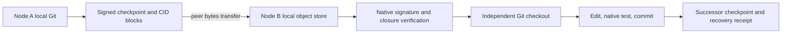

# Git development recovery between nodes

Tracked in [JUN-156](https://linear.app/kotobalabs/issue/JUN-156), related to
[JUN-289](https://linear.app/kotobalabs/issue/JUN-289) and
[AWAI-34](https://linear.app/kotobalabs/issue/AWAI-34).

`kotoba/git_checkpoint.kotoba` captures a quiesced task repository into
signed, CID-addressed objects. Another node verifies the objects and the
caller-supplied resume contract, creates an independent Git repository, and
continues development. Git directories and agent sessions are not synchronized.
The controller is Amu selfhost-built loaderless native code; Git and the
listed filesystem utilities are explicitly granted external tools.

## Existing implementation and the remaining gap

| Component inspected | Existing behavior | This change / remaining work |
| --- | --- | --- |
| Murakumo `d62bfbf` native agent-step/job-node | Input CID, admitted OCI launch, lease/fence and signed output receipt; no writable development checkout or portable Git checkpoint | This component captures/restores a development workspace separately. Job-node dispatch does not invoke it yet. |
| Kagami `eb90c54` source-control canary | Change/Revision/Snapshot identities, fixed West workspace and publication checks; current materializer is CLJK and reuses canonical local object stores | This native carrier is self-contained with respect to Git objects. It does not replace Kagami identities or qualify that materializer. A future native adapter must bind its Snapshot CID explicitly. |
| Itonami-agent `0c05574` / sahai `ba19195` | Separate Itonami rail, placement/epoch fence contracts | Restore checks an independently supplied author/profile/policy/environment/epoch/parent/task. These CLI inputs are not a distributed lease oracle. |
| Distributed storage | CID adapters and deployment inventory exist | Initial peer delivery is SSH/SCP of immutable objects. Yataverse/kura encrypted retention, replica receipts and automatic repair/eviction are still required. No B2 or shared mount is required. |



These are immutable proposals. No command in this component acquires a lease,
changes an accepted fleet head, publishes a source-control Change, or replays
an external operation. Nekko delegation, Kagami admission/projection and
sahai/qualified consensus remain separate admission steps.

## Data contract

The checkpoint is canonical JSON, raw CIDv1/sha2-256 addressed:
`{"payload":{...},"signature":"<Ed25519 base64url>"}`. It reuses the existing
native JCS, SHA-256, Ed25519, did:key and OCI digest/CID implementations.

The signed `itonami.git-checkpoint/1` payload contains exactly:

- `task`, signer `did`, `epoch`, and `parent` checkpoint CID (`root` initially);
- exact Git SHA-1 `head`, and `stash` snapshot commit (`none` for clean trees);
- `bundle`: CID of a canonical `itonami.git-bundle/1` chunk index;
- `profile`: SHA-256 digest of the supplied immutable profile artifact;
- `policy`, `environment`, `summary`: raw CIDs of the supplied bytes;
- sorted explicit `untracked` entries with `cid`, `mode` and relative `path`.

The Git bundle includes HEAD and the task's WIP commit with its index parent.
`git stash create` preserves staged and unstaged contents without stashing the
owner's working tree. A task-owned `refs/itonami/checkpoints/<commit>` keeps
the captured object graph reachable. No stash is pushed or popped. The bundle
has no prerequisite/excluded base and does not use alternates or shallow history.
Only this HEAD's reachable history is included, not every branch or reflog.

The profile, policy, environment descriptor, resume summary and each allowlisted
untracked file are objects too. A descriptor pin does not package every tool or
dependency named inside it. The destination node must independently provision
and qualify the pinned execution environment. This drill provisioned Amu by
an independently checked artifact digest. A full cold toolchain/dependency
resolver remains outside this component.

The format never contains node keys, credentials, old approvals, agent session
databases, process IDs, hooks, or repository configuration. Tracked source and
the explicit allowlist are the operator's selected data boundary. Profile and
policy bytes are recorded inputs, not grants to execute their contents.

## Commands and grants

All paths are absolute inside a task-owned filesystem scope. Pre-create the
object-store directory. Stop writers to the source repository for capture;
the final HEAD/status comparison detects some concurrent changes but is not a
lock. Give each restoration an exclusively owned destination parent and a new
destination name. Do not run two restores to the same path: the exists check
plus rename is not an atomic no-replace lock against concurrent creators.

```text
checkpoint capture REPO STORE KEY PROFILE_FILE POLICY_FILE ENV_FILE SUMMARY_FILE UNTRACKED_JSON EPOCH PARENT TASK
checkpoint verify  STORE CID AUTHOR_DID PROFILE_DIGEST POLICY_CID ENV_CID EPOCH PARENT TASK
checkpoint restore STORE CID AUTHOR_DID PROFILE_DIGEST POLICY_CID ENV_CID EPOCH PARENT TASK DEST
checkpoint recovery STORE FROM_CID TO_CID NODE_B_KEY TASK
checkpoint verify-recovery STORE RECEIPT_CID NODE_B_DID FROM_CID TO_CID TASK EPOCH
```

`UNTRACKED_JSON` is a canonical, sorted JSON array of selected paths, e.g.
`["resume.txt","src/new.kotoba"]`. No recursive collection of untracked or
ignored files occurs. An author DID, expected root CID and resume contract must
come from the authorized task, not from untrusted fields returned by a peer.
Exact equality is required for epoch and parent; there is no silent upgrade.
The identity pins the selected profile artifact; release/OCI admission still
belongs to the existing cell/job path.

Example host grant (Linux, after separately checking executable provenance):

```sh
export KEXE_ALLOW=20,35,37,38
export KEXE_CAP_RESOURCES_35="$CHECKPOINT_FS_SCOPE"
export KEXE_CAP_RESOURCES_20=/usr/bin/git:/usr/bin/mkdir:/usr/bin/stat:/usr/bin/chmod
export GIT_CONFIG_GLOBAL=/dev/null GIT_CONFIG_NOSYSTEM=1
export KEXE_SPAWN_ENV=PATH:GIT_CONFIG_GLOBAL:GIT_CONFIG_NOSYSTEM
```

Set `CHECKPOINT_FS_SCOPE` to an explicitly authorized common parent of the
selected repository, input files and store; a store-only scope cannot read
allowlisted source files in a separate worktree. Use this grant as written,
with a controlled PATH and exclusively owned files.
It deliberately supplies no HOME, SSH credentials, Git credential helpers or
inference credentials to children. The external-program grant itself is not an
OS filesystem sandbox for Git: the trusted launcher owns the selected paths.
Fixed argv requests disable Git hooks/fsmonitor/auto-GC/signing, templates and
global attributes; they do not invoke a shell. Repositories with configured
filters, tracked `.gitattributes`, submodules, or unmerged states are refused.
LFS and custom filter hydration are not supported by v1.

The command emits an exact named verdict line. Host supervisors must check
that verdict (`checkpoint/created`, `checkpoint/verified`,
`checkpoint/restored`, `recovery/recorded`, `recovery/verified`), not infer
success from the process exit alone. Native capability refusals can also trap.
Do not dispatch development work after any other result.

Restore verifies the root CID/signature/contract and the entire object closure
before creating `DEST.partial`. It assembles and reads back the bundle chunks,
initializes Git with no template, fetches the full checkpoint ref, checks out
the signed HEAD detached, applies WIP with `--index`, runs `git fsck`, and
restores the selected regular untracked files and modes. On success it fsyncs
the staging directory, renames it to DEST, and fsyncs the parent. A failed
materialization retains its partial directory; it never overwrites an existing
development tree. Files are fsynced, but this is not a qualified power-loss
durability/retention protocol for every imported object and Git internal file.

V1 bounds are explicit: Git SHA-1 repositories, 64 MiB per full bundle in
128 KiB chunks, 128 KiB per other object, 16 untracked regular files (0644 or
0755), 8 KiB checkpoint metadata, ASCII non-dot relative paths up to 120 bytes,
simple absolute repository/store/destination paths up to 128 bytes, and
positive epochs with up to nine decimal digits. Existing spawn budget is
16 KiB stdout / 10 seconds per child. Larger jobs need a separately qualified
streaming/budget extension; they must not fall back to mounted live Git state.
Each bundle chunk's hash/read/write temporaries live in an `arena-scope`.
Only its CID is copied into an outer fixed-size index table, so processing
many chunks does not retain every chunk's temporary allocations.

## Native build and gate

Use a new task workspace `G`, a fresh checkout `M` of this change, and the
canonical repository forest `K`. The only compiler executed below is the
pinned Amu-produced ELF. Shell/sed concatenate sources; they do not compile or
implement checkpoint decisions.

```sh
K=/Users/junkawasaki/github/kotoba-lang
# Set M and G to the selected task worktree/workspace first.
git -C "$K/amu" show dd35c6379e3b87f024bf685fa8d61af0aa07cea1:seed/bootstrap/aarch64-linux-static-root.elf > "$G/root.elf"
chmod +x "$G/root.elf"
# Required SHA-256: 688324e0fdc7a93a664ae55fe0ad417e7a980ab844656f3f97889812363c9479
shasum -a 256 "$G/root.elf"
pin() { git -C "$K/$1" show "$2:$3" | sed '1,/\]))$/d'; }
{
  echo '(ns checkpoint-native (:export [main]))'
  pin org-nist-sha2 ea83e70a6a8efb8fb12dd5f0031fcda35a9ec77b kotoba/sha2/core.kotoba
  pin org-ietf-ed25519 6f17477b5be91a0c8c369b8d30e7e5ea0c10a8aa kotoba/ed25519/selfhost.kotoba
  pin org-ietf-jcs 6331a9b461f5858be484b9d6859f314f9c3a2510 kotoba/jcs/reader.kotoba
  pin org-oci-distribution 90463924db65eea4d9021dc6623105472282b5a9 kotoba/oci/itonami_artifact.kotoba
  pin tsukasa 03e2322489839be2176d5c23d0ccb4120d1b0ee8 kotoba/tsukasa/ledger_core.kotoba
  pin tsukasa 03e2322489839be2176d5c23d0ccb4120d1b0ee8 kotoba/tsukasa/node_state.kotoba
  sed '1,/\]))$/d' "$M/kotoba/fleet_node_enrollment.kotoba"
  sed '1,/\]))$/d' "$M/kotoba/git_checkpoint.kotoba"
  echo '(defn main [] :i64 (checkpoint-main))'
} > "$G/checkpoint.kotoba"
# On native arm64 Linux, with G mounted at the same absolute path:
KEXE_CAP_RESOURCES_35="$G" "$G/root.elf" compile "$G/checkpoint.kotoba" --target aarch64-linux --output "$G/checkpoint-arm64.elf" --format static
KEXE_CAP_RESOURCES_35="$G" "$G/root.elf" compile "$G/checkpoint.kotoba" --target x86_64-linux --output "$G/checkpoint-x86_64.elf" --format static
```

For the regression gate, use the same closure, append
`kotoba/git_checkpoint_test.kotoba`, and use
`(defn main [] :i64 (test-git-checkpoint))` instead. The reported result must
be **31**. Removing the epoch check from `checkpoint-problem` gives **27**;
removing its signature check gives **29**. These negative compiler artifacts
must never be deployed. This change adds no CI workflow or legacy-runtime
fallback; repository CDCI remains in its existing state.

## Observed two-host drill, 2026-10-24

Evidence: [git-checkpoint-20261024.json](evidence/git-checkpoint-20261024.json).

- A: native arm64 Linux VM on the development Mac. B: separate physical
  `murakumo-ci-6600hs`, native x86_64 Linux. Two hardware hosts, not two
  containers counted as independent hosts.
- A captured a Git task fixture containing a 180 KiB binary addition, both
  index and unstaged changes, plus selected untracked 0644/0755 files. The
  bundle was 185,383 bytes, split into two chunks.
- Only CID objects and separately digest-pinned native tools were sent to B
  over SSH/SCP. A's known fixture paths were renamed out of the capture paths
  before B restored. A's machine was not powered off; B had no source mount,
  Git alternates or shallow prerequisites and made no request to A at restore.
- B restored the exact HEAD; both binary index and unstaged patches matched A
  byte for byte. Binary SHA-256 and untracked mode 0755 matched. `git fsck`
  passed.
- B edited the fixture's Kotoba result from 41 to 42, compiled and executed
  loaderless x86_64 code, committed only that source change while preserving
  inherited WIP, and made a checkpoint at epoch 2 with A's CID as parent.
- B produced and verified a signed `itonami.recovery/1` receipt connecting the
  two checkpoint CIDs. That successor checkpoint also restored independently.
- Missing/corrupted chunk, forged signature with a correctly recomputed root
  CID, wrong author/profile/policy/environment/task/epoch/parent were refused
  before any destination/partial tree was created. Existing destination data
  remained intact. Native regression/mutant results were 31 / 27 / 29.

The final controller was also exercised against this actual Murakumo task
worktree: HEAD `d62bfbf`, 1,284 tracked paths, the README WIP and the three
explicitly selected new checkpoint source/document files. Its full Git bundle
was **6,628,028 bytes / 51 chunks**. B restored the real repository, verified
both Kotoba source digests, added `kotoba/recovery_drill_check.kotoba`, compiled
and ran that regression with result **1**, committed the resumed development
as `29983a00823979873b5cdd86dc521b9440b68c6b`, and captured the clean successor
at epoch 2. That commit is a retained drill branch on B, not a publication to
Murakumo main. The corresponding signed recovery receipt was verified.

During qualification, a store-only filesystem scope correctly refused the
separate source worktree. The corrected run explicitly granted the common
parent. Per-chunk arenas also reduced sampled capture RSS from 677,424 KiB
before reclamation to 15,816 KiB with reclamation; these are diagnostic
samples, not peak-memory or throughput benchmarks.

This qualifies these selected Git recovery workloads and native targets.
The profile is a fixture descriptor and no inference call occurred. It does
not qualify automatic placement, a production profile's resumed inference
turn, Nekko/Kagami admission, on-chain receipt anchoring, app/browser consent
integration, or arbitrary repository sizes/features. Hermes, Codex and Claude
worktree stores/configuration are unchanged.

Keep local caches until a separate retention protocol has independently
verified persistent replicas, expiry/pinning and cold readback in the required
failure domains. This component does not evict caches, claim durable replica
quorum, or introduce an origin-side application server.
